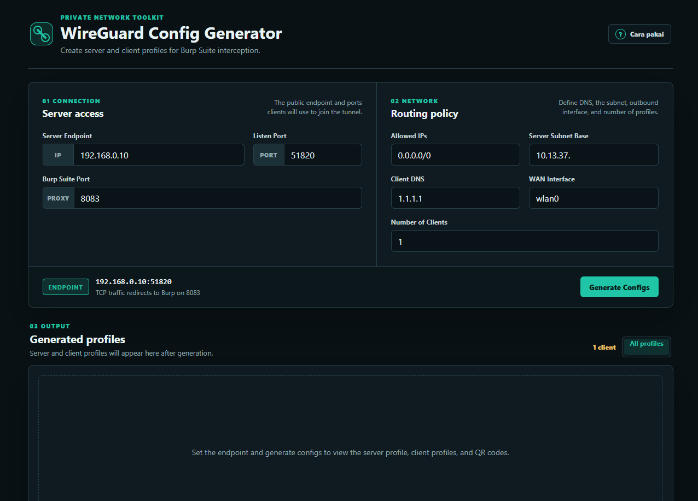

# WireGuard Config Generator

Generator konfigurasi WireGuard berbasis web untuk membuat profil server dan client yang siap dipakai untuk kebutuhan Burp Suite interception.

## Preview



## Fitur

- Membuat keypair WireGuard server dan client langsung di browser.
- Menghasilkan konfigurasi server dengan aturan NAT, forwarding, DNS redirect, dan TCP redirect ke port Burp Suite.
- Mendukung pembuatan banyak profil client sekaligus.
- Menampilkan QR code untuk setiap profil agar mudah diimpor ke aplikasi WireGuard mobile.
- Menyediakan panduan cepat untuk setup WireGuard Linux, import client mobile, dan proxy listener Burp Suite.
- Berjalan sebagai halaman statis tanpa backend dan tanpa proses build.

## Struktur Proyek

```text
index.html
favicon.ico
js/
  nacl-fast.min.js
  qrcode.min.js
assets/
  readme-preview.png
  tutorial/
```

## Cara Menjalankan

Clone repository:

```bash
git clone https://github.com/patarisac/wg-config.git
cd wg-config
```

Buka `index.html` langsung di browser, atau jalankan server lokal sederhana:

```bash
python -m http.server 8000
```

Lalu buka:

```text
http://localhost:8000
```

## Cara Pakai

1. Isi `Server Endpoint` dengan IP atau domain server yang bisa diakses client.
2. Isi `Listen Port` sesuai port WireGuard server, default `51820`.
3. Isi `Burp Suite Port` sesuai proxy listener Burp, default `8083`.
4. Atur `Allowed IPs`, `Server Subnet Base`, `Client DNS`, `WAN Interface`, dan jumlah client.
5. Klik `Generate Configs`.
6. Salin konfigurasi `Server` ke `/etc/wireguard/wg0.conf` di server Linux.
7. Import konfigurasi `Client` dari QR code atau salin konfigurasi client secara manual.
8. Pastikan Burp Suite proxy listener menggunakan port yang sama dan binding ke semua interface.

## Contoh Setup Server

Install WireGuard:

```bash
sudo apt install wireguard
```

Simpan konfigurasi server:

```bash
sudo nano /etc/wireguard/wg0.conf
```

Amankan file konfigurasi dan jalankan interface:

```bash
sudo chmod 600 /etc/wireguard/wg0.conf
sudo wg-quick up wg0
```

Cek status WireGuard:

```bash
sudo wg
```

## Catatan Keamanan

- Private key dibuat di browser dan tidak dikirim ke server mana pun.
- Jangan membagikan konfigurasi yang berisi `PrivateKey`.
- Gunakan endpoint, subnet, DNS, dan interface jaringan yang sesuai dengan environment server.
- Review aturan `PostUp` dan `PostDown` sebelum dipakai di server produksi.
